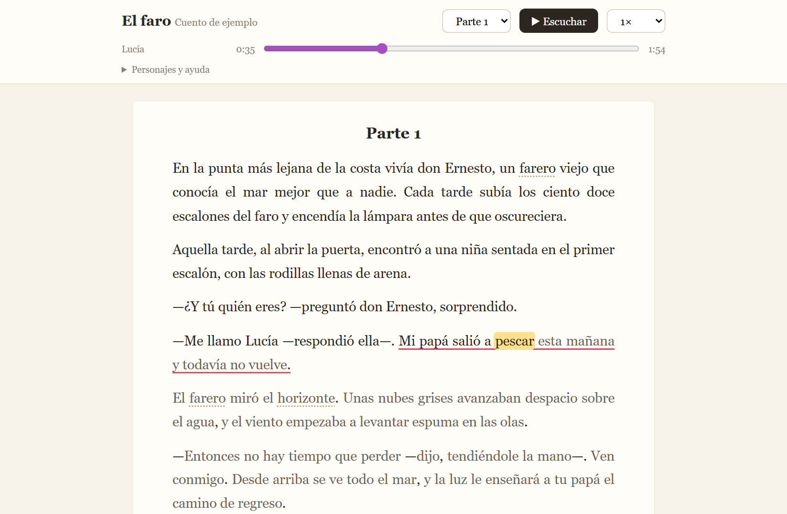
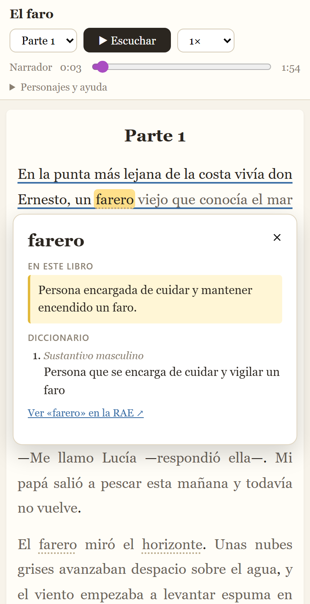

# narrador-ia

Convierte un libro (**PDF, EPUB o TXT**) en un **audiolibro con una voz distinta para cada personaje**,
y un **lector web** que resalta cada palabra mientras se escucha.

- 🎭 **Una voz por personaje.** Gemini lee cada capítulo, decide quién dice cada línea de diálogo
  y la herramienta reparte las voces según el género y la edad de cada personaje.
- ✨ **Guía de lectura.** La palabra que se está diciendo se ilumina, como en el lector de Microsoft Edge,
  y el texto se subraya con el color del personaje que habla.
- 📖 **Significado de las palabras.** Con doble clic o clic derecho (en el teléfono: mantener presionado)
  sobre una palabra se abre una ficha que explica qué quiere decir **en ese momento del libro**,
  más la definición de Wikcionario y un enlace a la RAE.
- 🖼️ **Con los dibujos del libro**, cada uno en su lugar.
- 🔖 Selector de capítulos, velocidad de lectura, y recuerda dónde te quedaste.

<p align="center">
  
  
</p>

*Capturas del cuento de ejemplo [`ejemplo/el_faro.txt`](ejemplo/el_faro.txt). Pruébalo con
`python narrador.py crear ejemplo/el_faro.txt --titulo "El faro"`.*

Las voces son las voces neuronales de Microsoft Edge (gratis, con conexión a internet), usando
[edge-tts](https://github.com/rany2/edge-tts).

## Instalación

Necesitas **Python 3.10+** y **[ffmpeg](https://ffmpeg.org/download.html)** en el PATH.

```bash
git clone https://github.com/YeyoDiego223/narrador-ia.git
cd narrador-ia
pip install -r requirements.txt
```

Para que la IA reconozca a los personajes, consigue una clave **gratis** de Gemini en
<https://aistudio.google.com/apikey> y crea un archivo `.env` en la carpeta del proyecto:

```
GEMINI_API_KEY=tu_clave_aqui
```

## Uso

```bash
# Libro completo
python narrador.py crear mi_libro.epub

# Para probar rápido: solo los primeros 3 capítulos
python narrador.py crear mi_libro.pdf --capitulos 3

# Sin IA (todas las líneas de diálogo con la misma voz)
python narrador.py crear mi_libro.txt --sin-ia
```

Al terminar, abre `salida/<nombre_del_libro>/lector.html` en el navegador.

Si se corta a la mitad (internet, límite de Gemini…), vuelve a correr el mismo comando: retoma donde se quedó.

### Leerlo en el teléfono

Desde la carpeta del libro, levanta un servidor en tu red local y abre la dirección en el teléfono
(conectado al mismo WiFi):

```bash
cd salida/mi_libro
python -m http.server 8080
# en el teléfono: http://IP-DE-TU-PC:8080/lector.html
```

## Corregir voces o personajes

Todo queda en `salida/<libro>/proyecto.json`:

- `voces`: la voz de cada personaje (`voz`, `rate` = velocidad, `pitch` = tono, `color`).
  Lista de voces: `edge-tts --list-voices`.
- `capitulos[].segmentos[].p`: quién dice cada línea.
- `glosario`: las palabras explicadas (`palabra@capítulo`).

Después de editarlo:

```bash
python narrador.py generar salida/mi_libro
```

Solo se vuelven a generar las líneas que cambiaron.

## Opciones

| Opción | Qué hace |
|---|---|
| `--capitulos N` | Solo los primeros N capítulos |
| `--sin-ia` | No usa Gemini |
| `--glosario N` | Palabras explicadas por capítulo (15 por defecto, 0 = ninguna) |
| `--narrador VOZ` | Voz del narrador (por defecto `es-MX-JorgeNeural`) |
| `--idioma es` | Idioma de las voces (`es`, `en`, `fr`…) |
| `--titulo`, `--autor` | Para cuando el archivo no los trae |
| `--desde-cero` | Ignora el avance guardado y empieza de nuevo |

Modelo de Gemini: `gemini-3.5-flash` por defecto; se cambia con la variable de entorno `GEMINI_MODEL`.

## Cómo funciona

1. **Extraer** (`narrador/extraer.py`): texto en capítulos y párrafos, quitando encabezados,
   pies y números de página repetidos; saca los dibujos.
2. **Diálogos** (`narrador/dialogos.py`): corta cada párrafo en narración y réplicas según las rayas (—),
   incluidos los incisos del narrador (`—Hola —dijo él—, ¿qué tal?`).
3. **IA** (`narrador/ia.py`): Gemini dice quién dice cada réplica y escribe el glosario del capítulo.
4. **Voces** (`narrador/voces.py`): reparte las voces de Edge por género y edad.
5. **Audio** (`narrador/audio.py`): genera cada línea con el tiempo exacto de cada palabra y une todo en `audio.mp3`.

## Derechos de autor

Usa esta herramienta con libros **tuyos o de dominio público**, o solo para tu uso personal.
No publiques audiolibros de obras protegidas por derechos de autor.

## Licencia

MIT
